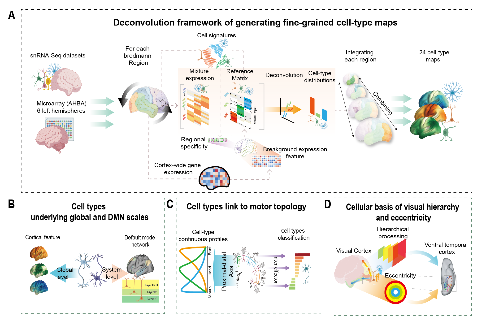

# A Fine-Grained Cellular Atlas Maps Nested Organizational Axes of Human Cortex

Code accompanying the manuscript on cortical cell-type maps, analysis across nested organizational axes.

## Overview
<p align="center">
  
</p>

This repository provides preprocessing and analysis scripts that support reproduction of the main results and selected supplementary results in our study.

The code is organized into two major parts: `preprocessing/` and `analysis/`. 

`Preprocessing/` scripts cover single-nucleus reference preparation, region-specific deconvolution input construction, and integration of region-wise outputs into cortex-wide cell-type maps. 

`Analysis/` scripts are further grouped into global, DMN, M1, and visual modules following the structure of the manuscript.

The processed cell-type maps used throughout the analyses are available in `results/celltype_map`. Parcellated versions of these maps are also provided in `results/parcellated_Cammoun033_no_corpuscallosum`,`results/parcellated_Schaefer400`and `results/parcellated_Glasser360`.

The `materials/` folder provides supporting materials for reproducing the analyses, including intermediate data, annotation files, and other input resources used by the preprocessing and analysis scripts.

The repository already includes the full code for the major analytical steps and will be further updated and refined as the project continues to develop.

## Repository structure

```text
fine-grained-cellular-atlas-cortex/
├── preprocessing/
│   ├── P00_filtering_downstream analysis.R
│   ├── P01_celllabel_reannotation.R
│   ├── P02_rds_to_h5ad.R
│   ├── P03_1_integrate_data.py
│   ├── P03_2_DEG_acrossroi.py
│   ├── P04_roi_h5ad_to_roi_rds.R
│   ├── P05_roi_rds_for_deconvolution.R
│   ├── P06_integrate_roi_deconvolution.py
├── analysis/
│   ├── global_celltype_correlation.py
│   ├── global_pr_ai_index_align.py
│   ├── global_celltype_pls_receptors.py
│   ├── global_disease_exposure.py
│   ├── dmn_cyto.py
│   ├── dmn_enav.py
│   ├── m1_region_effector.py
│   ├── m1_scan.py
│   ├── visual_pc.py
│   ├── visual_vtc.py
│   └── celltype_in_fc_gradient.py
├── materials/    
└── results/
    ├── celltype_map/
    ├── parcellated_Cammoun033_no_corpuscallosum/
    └── parcellated_Schaefer400/
    └── parcellated_GLasser360/
```
## Code for the paper
The repository is organized into two major code folders: `preprocessing/` and `analysis/`.

### Preprocessing scripts  from overview (A)

The preprocessing scripts provide a basic reference framework for deconvolution, covering single-nucleus reference preparation, region-specific input construction, and output integration. With minor modifications, this framework can be adapted to custom single-nucleus references, spatially aligned gene-expression maps, or alternative deconvolution settings.

#### Input data

The deconvolution framework uses two types of input data.

**Single-nucleus RNA-seq reference data**

- Jorstad et al. https://doi.org/10.1126/science.adf6812 
- Siletti et al. https://doi.org/10.1126/science.add7046

Processed single-nucleus RNA-seq data can be accessed from CELLxGENE:  
`https://cellxgene.cziscience.com`

**Spatially aligned gene-expression reference profiles**

- Wagstyl et al. MAGICC gene-expression maps https://github.com/kwagstyl/MAGICC
- Ecker et al. gene-expression maps https://gin.g-node.org/sphache/DecodeGABAData

Other spatially aligned cortical gene-expression maps, such as maps generated using alternative AHBA preprocessing pipelines, can also be used after matching gene names, cortical space, and regional or parcellation definitions.

#### Scripts

- **`preprocessing/P00_filtering_downstream analysis.R`**  
  Performs initial filtering of single-nucleus RNA-seq data before downstream annotation, integration, and deconvolution reference construction.

- **`preprocessing/P01_celllabel_reannotation.R`**  
  Reannotates cell-type labels across datasets using Seurat label transfer, with the Jorstad et al. 8-region, 24-cell-type annotation as the reference framework.

- **`preprocessing/P02_rds_to_h5ad.R`**  
  Provides basic code for converting Seurat `.rds` objects to `.h5ad` format for Python-based analysis.

- **`preprocessing/P03_1_integrate_data.py`**  
  Integrates single-nucleus RNA-seq datasets across 33 independent cortical regions for downstream region-specific reference construction.

- **`preprocessing/P03_2_DEG_acrossroi.py`**  
  Uses Memento to identify cell-type-specific differentially expressed genes across cortical regions, mainly for robustness checks and supplementary analyses.

- **`preprocessing/P04_roi_h5ad_to_roi_rds.R`**  
  Provides basic code for converting region-specific `.h5ad` files back to Seurat `.rds` format.

- **`preprocessing/P05_roi_rds_for_deconvolution.R`**  
  Prepares region-specific single-nucleus reference matrices for deconvolution by organizing cell-type-specific expression profiles.

- **`preprocessing/P06_integrate_roi_deconvolution.py`**  
  Integrates region-wise deconvolution results into unified cortex-wide cell-type maps for downstream analyses.

### Analysis scripts from overview (B–D)

The analysis scripts use the processed cortex-wide cell-type maps to examine how cellular composition is organized along nested axes of the human cortex. The main analytical logic follows the structure of the manuscript and overview figure: global cortex-wide analyses and DMN analyses correspond to overview (B), M1 analyses correspond to overview (C), and visual cortex analyses correspond to overview (D).

Here, scripts with the prefix `global_` refer to cortex-wide analyses. These analyses evaluate whether the 24 cell-type maps capture broad cortical organizational patterns, including large-scale functional and anatomical axes, receptor-related variation, and disease-related spatial vulnerability.

The `dmn`, `m1`, and `visual` modules then extend this framework to system-level and local-scale axes.

#### Global analyses from overview (B)

- **`analysis/global_celltype_correlation.py`**  
  Examines cortex-wide relationships among the 24 cell-type maps and summarizes their large-scale organizational structure.

- **`analysis/global_pr_ai_index_align.py`**  
  Tests the alignment between cell-type distributions and a canonical cortical Pr-Al axis, providing a global benchmark for the cellular atlas.

- **`analysis/global_celltype_pls_receptors.py`**  
  Relates cell-type spatial patterns to neurotransmitter receptor density maps using partial least squares analysis.

- **`analysis/global_disease_exposure.py`**  
  Evaluates associations between cell-type maps and spatial patterns of disease-related cortical vulnerability or exposure.

- **`analysis/celltype_in_fc_gradient.py`**  
  Projects cell-type maps into functional gradient space to examine how different cell classes are positioned along large-scale cortical functional axes.

#### DMN analyses from overview (B)  
These analyses were conceptually informed by recent work characterizing the default mode network through cytoarchitecture, wiring, and signal flow, particularly Paquola et al. (2025).

- **`analysis/dmn_cyto.py`**  
  Analyzes cellular variation within the default mode network and relates DMN cell-type patterns to cytoarchitectural organization.

- **`analysis/dmn_enav.py`**  
  Examines cell-type variation along DMN-related functional or anatomical axes, highlighting system-level heterogeneity within the default mode network.

#### M1 analyses from overview (C) 
These analyses were motivated by recent evidence that primary motor cortex contains inter-effector regions linked to the somato-cognitive action network, as described by Gordon et al. (2023).

- **`analysis/m1_region_effector.py`**  
  Investigates cell-type organization across primary motor cortex territories and examines cellular variation related to the proximal–distal motor topology.

- **`analysis/m1_scan.py`**  
  Analyzes cell-type signatures of inter-effector regions in M1 and their relationship to broader motor and control-related organization.

#### Visual cortex analyses from overview (D)  
These analyses were informed by recent work linking visual cortical organization, ventral temporal cortex architecture, eccentricity, and category-selective organization, including Kubota et al. (2025).


- **`analysis/visual_pc.py`**  
  Examines cellular variation along major axes of visual cortical organization, including visual hierarchy and eccentricity-related structure.

- **`analysis/visual_vtc.py`**  
  Focuses on the ventral temporal cortex and analyzes how cell-type distributions relate to visual processing organization within this region.


### Key conceptual references for analyses

- Paquola, C. et al. (2025). The architecture of the human default mode network explored through cytoarchitecture, wiring and signal flow. *Nature Neuroscience*. https://doi.org/10.1038/s41593-024-01868-0
- Gordon, E. M. et al. (2023). A somato-cognitive action network alternates with effector regions in motor cortex. *Nature*, 617, 351–359. https://doi.org/10.1038/s41586-023-05964-2
- Kubota, E. et al. (2025). White matter connections of human ventral temporal cortex are organized by cytoarchitecture, eccentricity and category-selectivity from birth. *Nature Human Behaviour*. https://doi.org/10.1038/s41562-025-02116-6
